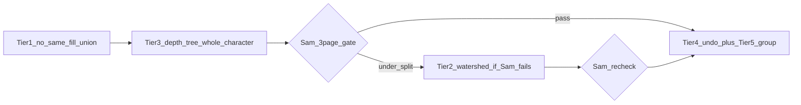

# Team Review — Character Grouping + Undo (UX Path Forward)

**Trigger from Tony:** grouping still wrong; must move **individual whole characters**; need **undo**;
characters must be **clearly separated**.

**Participants:** Akansha (Product), Sam (Design), Hari (Engineering).  
**Date:** 2026-06-16  
**Inputs:** [object-grouping-discussion.md](./object-grouping-discussion.md), Hari’s research plan
(Character Grouping + Undo), Tony’s choice: **whole character** = one draggable unit (all colour
patches move together).

---

## Akansha — UX framing

### The job to be done (updated)

> **When I click a character on the page, I move that character — not a colour patch, not two
> characters at once, and not half the background.**

Tony was explicit: **whole character**, not per-patch editing. That settles the biggest product
question from the first grouping discussion.

### What “works as expected” means (acceptance)

| # | User action | Expected result | Failure mode we refuse to ship |
|---|-------------|-----------------|--------------------------------|
| 1 | Click foreground dinosaur | One coral selection around **all** its fills (body, belly, neck, eye) | Belly drags alone |
| 2 | Click second dinosaur nearby | **Separate** selection from the first | Both move together because they share `greenMid` |
| 3 | Click mesa | Mesa only — sky and ground stay | Sky band included in selection |
| 4 | Drag character 30px | Character moves; background unchanged | White seam > 2px (separate H2 gate) |
| 5 | Cmd+Z after drag | Character returns to prior position | No undo, or undo lost on tab switch without warning |
| 6 | Re-vectorize after update | New grouping applies | Silent stale groups |

**Priority order (non-negotiable):** no false merges → whole character → undo → manual Group fallback.

I’d rather ship 50 layers that are mostly right + Group/Ungroup than 25 layers with 5 wrong mergers
and no way to fix them.

### UX concerns with Hari’s 5-tier plan as written

| Tier | Engineering logic | Product concern |
|------|-------------------|-----------------|
| 1 Remove same-fill union | Fixes tree fusion | Good — **ship first** |
| 2 Watershed split | Splits touching same-colour blobs | Risk: **over-splits** one long character (sauropod neck = two peaks). Sam must gate |
| 3 Depth-tree | Whole-character assembly | This is what Tony asked for — should **not** wait until after watershed |
| 4 Undo | Command stack | Users expect this in **any** editor — OK to build in parallel once Tier 1 lands |
| 5 Group/Ungroup | Escape hatch | Not “Phase 5 luxury” — **required** for ChatGPT art with micro-gaps between belly and body |

**Reorder:** Tier 1 → Tier 3 → Tier 2 (only if Sam finds under-split) → Tier 4 + 5 together.

### Undo — UX requirements

- **Cmd+Z / Cmd+Shift+Z** in Edit mode (standard).
- Inspector **Undo / Redo** buttons with clear disabled state.
- One undo step = one completed drag (not every pointer-move frame).
- **Honest limitation v1:** session-only undo is acceptable **if** we say so once in the Inspector
  (“Undo applies until you reload”). Persisted undo is v2 — don’t silently drop edits on reload
  without explanation.
- Undo scope v1: move, resize, layer reorder. Group/Ungroup when Tier 5 lands.

### What we are not building in this milestone

- ML “Illustrator’s Depth” or anime layer decomposition (See-through / SAM) — wrong product, wrong
  team size.
- Semantic labels (“Dinosaur 1”) — layer list stays `Shape N · slotName`.
- Auto-fix without re-vectorize — stale `sceneId` must re-vectorize; keep the Inspector note.

---

## Sam — design review

### What I see today (after first grouping fix)

The union-find pass **still merges all touching same-fill clusters**. That’s why two trees sharing
`greenMid` become one “Shape 7 · greenMid” — Tony’s report matches the code (`same_fill => true` in
`should_union`).

Cross-fill merge (belly on body) is **too weak** for some uploads: if belly and body don’t touch at
pixel level after trace, we get a split character. That’s a **gap in the art**, not something we
pretend away.

### Visual sign-off protocol (unchanged, stricter)

On **reference crop + 2 user uploads**, Edit mode:

1. **Whole character:** click sauropod → single coral outline encloses all fills.
2. **Separation:** click each of two foreground characters → distinct outlines.
3. **Background safety:** click mesa → no sky in selection bbox.
4. **Drag:** move largest character 30px → screenshot at 100%; no seam > 2px on flat fills (H2).
5. **Watershed check (when Tier 2 ships):** long neck / tail must not split into two selectable
   objects unless they are genuinely separate creatures.

I will **fail** Tier 2 if watershed turns one sauropod into “head object + body object.”

### Design affordances (ship with grouping fix)

| Element | Spec |
|---------|------|
| Selection | 2px coral stroke on all paths in group — already in CSS |
| Layer list | Show **one row per draggable object**; selecting row = same as canvas click |
| Mis-grouped page | Inspector note: *“Some shapes may need grouping — select layers and tap Group.”* (after Tier 5) |
| Undo | Subtle “Undone” toast optional; keyboard is enough for v1 |

### On algorithm choice

- **Watershed:** good for “two green circles touching” — classic [scikit-image](https://scikit-image.org/docs/stable/auto_examples/segmentation/plot_watershed.html) use case. Fragile on **elongated** folk-art silhouettes.
- **Depth-tree (VTracer first pass):** aligns with how the engine already thinks about stacked shapes — prefer this for **whole character** before we split anything.
- **Felzenszwalb:** defer unless watershed + depth-tree fail on 3 test pages — extra tuning surface.

---

## Hari — engineering response

### Root cause (confirmed)

```rust
// scene.rs — current bug
if same_fill(a, b) {
    return true;  // fuses separate characters sharing a hex
}
```

Tier 1 is a **one-line policy change** plus tests — not a rewrite.

### Agreed implementation order (revised with team)



| Step | Work | Est. | Gate |
|------|------|------|------|
| **A** | Tier 1: remove same-fill union; cross-fill gestalt + background guard only | ½–1 day | Parity + two-blob test; Sam: no fused trees |
| **B** | Tier 3: preserve first-pass `depth` / `merged_into`; depth-tree union for whole character | 2 days | Sam: dino = one click |
| **C** | Tier 2: watershed **only** on clusters Sam flags as under-split | 1–2 days | Sam: no neck split |
| **D** | Tier 4 + 5: `sceneHistory.ts` + Group/Ungroup in Inspector | 2 days | Tony: undo + manual fix |

**Parallel track:** Step D can start when Step A merges — undo does not depend on watershed.

### Tier 1 detail (immediate)

Union edge only if touching AND:

- **Cross-fill gestalt** (small detail on foreground: belly, eye), OR
- **Same depth-tree component** (after Step B — until then, no same-fill union at all)

After Step A alone, multi-fill characters may still split if patches don’t touch — **expected**
until Step B; Group UI (Step D) covers gap cases.

### Tier 3 detail (whole character — Tony’s ask)

- Run first hierarchical pass with `deepen`; record `merged_into` / `depth` per cluster before
  cutout second pass.
- Union-find: merge touching clusters if same depth-tree ancestor (foreground) OR cross-fill gestalt.
- Never merge into background bands (`depth == 0` or area > ⅓ image).

References: visioncortex `builder.rs` `merge_cluster_into`, [Illustrator’s Depth + VTracer pipeline](https://arxiv.org/html/2511.17454) (conceptual only — we use engine metadata, not ML).

### Tier 2 detail (conditional)

- Only run watershed on clusters with area > 2% image **and** Sam marks “multiple instances in one
  cluster” on test pages.
- Parameters conservative: minimum distance between peaks to avoid neck splits.
- Port minimal distance-transform + watershed in `watershed.rs` (avoid heavy deps in WASM).

### Undo detail

- Command pattern ([standard for SVG editors](https://github.com/pplaissy/undo-redo)) — not full
  scene snapshot.
- Commands: move, resize, reorder; add `GroupObjectsCommand` / `UngroupCommand` with Step D.
- Push on pointer-up; cap 50; debounced IndexedDB save after apply/revert.

---

## Round 1 — Disagreements

### Order: watershed before or after depth-tree?

**Hari (original plan):** Tier 2 before Tier 3 — split instances first, then assemble character.

**Sam:** Depth-tree first. Watershed on a sauropod body mask can produce two peaks (head blob + body
blob) and **break** whole-character UX. Split only when we have evidence of two instances.

**Akansha:** Agree with Sam. Tony wants **whole character**, not **more objects**. Under-split is
fixable with Group; over-split forces manual Group on every character.

**Resolved:** Tier 3 before Tier 2.

### Is Group/Ungroup Phase 5 or required?

**Hari:** Nice-to-have after auto grouping stable.

**Akansha:** Required for v1 of “editable canvas.” ChatGPT uploads will have 1–2px gaps. Without
Group, we fail Tony on belly/body splits even when auto is “good enough.”

**Sam:** Agree. Layer list multi-select + Group is the Illustrator muscle memory users expect.

**Resolved:** Ship Group/Ungroup with undo (Step D), not later.

### Session-only undo — acceptable?

**Hari:** Persisting undo history in IndexedDB is extra scope.

**Akansha:** Acceptable for v1 **with one line of copy** in Inspector. Reload = fresh history is
normal for lightweight web tools if we say so.

**Sam:** Fine. Don’t show Undo enabled after reload if stack is empty — no fake affordance.

**Resolved:** Session undo v1; persisted undo backlog.

---

## Round 2 — Agreed path forward

### Decision summary

| Question | Answer |
|----------|--------|
| One draggable unit? | **Whole character** (all fills) |
| Worst failure? | **Over-merge** (two characters one object) |
| First code change? | **Remove same-fill blanket union** (Tier 1) |
| Whole character assembly? | **Depth-tree from VTracer first pass** (Tier 3) — before watershed |
| Touching same-colour instances? | **Watershed only if Sam gate fails** (Tier 2) |
| When user auto fails? | **Group / Ungroup** in Inspector (Tier 5) |
| Undo? | **Command stack**, keyboard + buttons; session v1 |
| ML segmentation? | **No** this milestone |
| Re-vectorize? | Required after engine change; keep Inspector note |

### Ship gates (binary)

**Gate A (after Step A):** No two non-touching same-colour characters share one object; parity green.

**Gate B (after Step B):** Reference sauropod = one selection; Sam 3-page click test.

**Gate C (optional Step C):** Only if Gate B fails on “two touching same-colour characters” — Sam
approves watershed params.

**Gate D (after Step D):** Move → Undo restores; Group merges selection → moves as one.

**Do not announce “grouping fixed” to Tony until Gate B passes.**

### Tony-facing checklist (what he should verify)

1. Re-vectorize each test page after deploy.
2. Edit mode → click each dinosaur → one outline each.
3. Drag one character → Cmd+Z → back to start.
4. If belly split from body → select both in layer list → Group → drag once.
5. Raster download / lightbox still works.

---

## Action items

| Owner | Action |
|-------|--------|
| **Hari** | Step A: remove `same_fill => union`; ship behind wasm rebuild |
| **Hari** | Step B: depth-tree grouping spike + integrate |
| **Hari** | Step D: `sceneHistory.ts` + Inspector undo + Group/Ungroup (parallel after A) |
| **Hari** | Step C: only if Sam requests on test pages |
| **Sam** | Run Gates A–B on reference + 2 uploads; file screenshots of failures |
| **Akansha** | Update success metrics in PRD checklist; block “done” until Gate B + D |

---

## References

- Prior discussion: [object-grouping-discussion.md](./object-grouping-discussion.md)
- Hari research plan: Character Grouping + Undo (Cursor plan)
- Watershed: [scikit-image watershed segmentation](https://scikit-image.org/docs/stable/auto_examples/segmentation/plot_watershed.html)
- Depth + VTracer (deferred ML): [Illustrator’s Depth (arXiv 2511.17454)](https://arxiv.org/html/2511.17454)
- Undo pattern: [Command pattern for undo/redo](https://sbcode.net/typescript/command/)
- Current bug: [`app/wasm-vtracer/src/scene.rs`](../app/wasm-vtracer/src/scene.rs) `should_union` lines 27–30

---

## Appendix — UX copy (approved)

| Location | Copy |
|----------|------|
| Inspector (vector done) | Re-vectorize to refresh object groups after an update. |
| Inspector (Edit mode, post–Group) | Select multiple layers and tap Group to move them together. |
| Inspector (undo v1) | Undo applies until you reload this page. |
| Toast (optional) | Undone / Redone |
